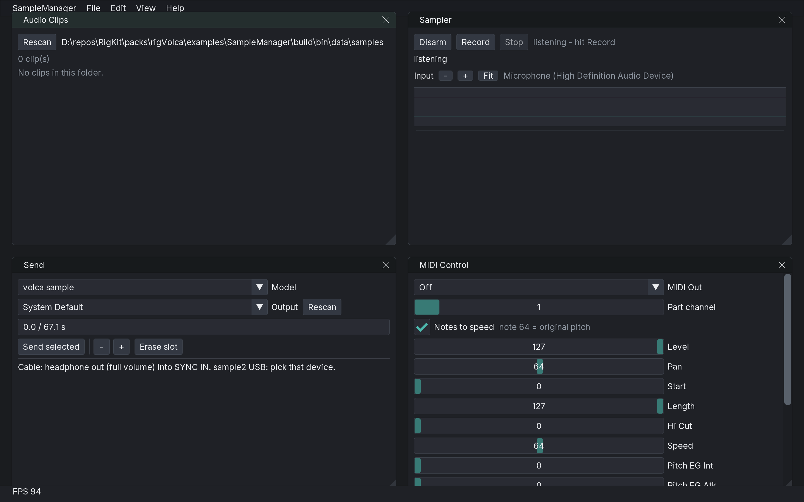

# rigVolca



Korg **volca sample** (and sample2) transfer plus MIDI control.

- **Syro** — encode a clip as the audio stream the hardware expects, then play it bit-clean into SYNC IN (cable) or the sample2 USB audio device.
- **MIDI** — CC tables, chromatic notes-to-speed, a 24 ppqn clock, and a /1–/8 divider. Ported from [pd-volka](https://github.com/GitBruno/pd-volka).

Example app: [`examples/SampleManager`](examples/SampleManager). KidVJ records clips; this app sends them.

## API sketch

```cpp
using namespace rigkit::volca;
PreparedSample prep;
prepareSample("clip-1.wav", prep);

Capacity cap(VolcaModel::Sample2);
if (!cap.canFit(prep).ok) { /* trim or skip */ }

SyroStream stream;
encodeSend(0, prep, stream);   // slot 1 on the hardware
SyroPlayer player;
player.play(stream, /* device index */ 0);
```

Chromatic playback (MIDI note 64 = original speed, each step a semitone):

```cpp
notesToSpeed(*midi, /* channel */ 1, note, velocity);
```

## Hardware limits

| | volca sample | volca sample2 |
|--|--|--|
| Slots | 100 (0–99) | 200 (0–199) |
| Sample FLASH | 4 MiB (~65 s at 31.25 kHz 16-bit mono) | 4 MiB |
| Native rate | 31.25 kHz, 16-bit, mono | same |

`Capacity::canFit` refuses the next sample when it would overflow the 4 MiB budget.

## MIDI CC

### volca sample (parts on channels 1–10)

| CC | Control | Notes |
|--:|--|--|
| 7 | LEVEL | |
| 10 | PAN | |
| 40 | SAMPLE START POINT | |
| 41 | SAMPLE LENGTH | |
| 42 | HI CUT | |
| 43 | SPEED | 0–127 maps to -63–63; 64 is original pitch |
| 44 | PITCH EG INT | 0–127 maps to -63–63 |
| 45 | PITCH EG ATTACK | |
| 46 | PITCH EG DECAY | |
| 47 | AMP EG ATTACK | |
| 48 | AMP EG DECAY | |

### volca FM (MIDI RX ShortMessage = On)

| CC | Control |
|--:|--|
| 40 | TRANSPOSE |
| 41 | VELOCITY |
| 42 | MODULATOR ATTACK |
| 43 | MODULATOR DECAY |
| 44 | CARRIER ATTACK |
| 45 | CARRIER DECAY |
| 46 | LFO RATE |
| 47 | LFO PITCH DEPTH |
| 48 | ALGORITHM |
| 49 | ARP TYPE |
| 50 | ARP DIV |

## Global settings

Hold **FUNC** while powering on.

| Step | Control | Notes |
|--:|--|--|
| 1 | auto-power-off | on/off |
| 2 | battery type | nH (rechargeable) or AL (alkaline) |
| 3 | polarity sync out | Low / High |
| 4 | polarity sync in | Low / High |
| 5 | bpm range | nR (Narrow: 60–240) FR (Full: 10–600) |
| 6 | MIDI clock | Au (Auto) / In (Ignore) |
| 7 | MIDI RX ShortMessage | on/off |
| 8 | Sync input/output unit | Once a step / Once every 2 steps |

## Syro transfer

See [docs/syro.md](docs/syro.md).

Vendored encoder: Korg [volcasample](https://github.com/korginc/volcasample) Syro library (BSD-3-Clause, © 2014 KORG Inc.). Copy: [`third_party/korg_syro/COPYING`](third_party/korg_syro/COPYING). Local patches: slot range 200 (sample2 slots 100–199; original firmware ignores those); `korg_syro_type.h` uses `<stdbool.h>` so GCC C23 does not choke on `typedef int bool`.

Pack license: MIT Rigkid Contributors.

[API/docs](https://rigkid.github.io/rigVolca/)
