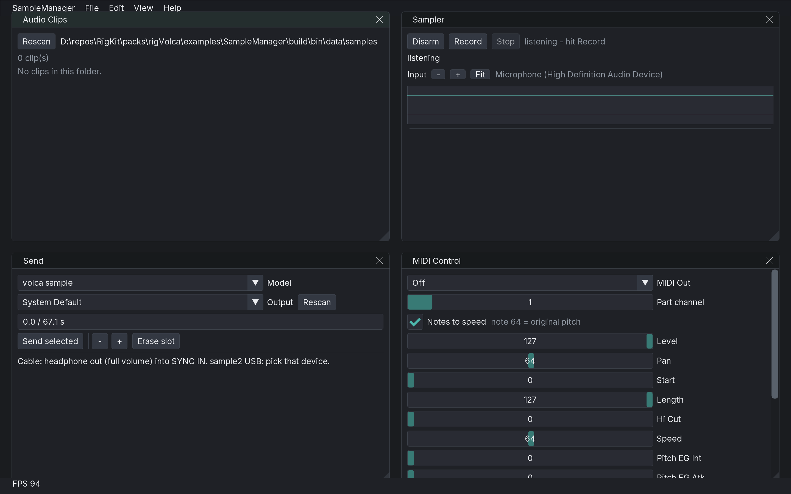

# SampleManager



rigVolca example: browse and record clips, Syro-send them to a **volca sample** or **sample2**, and play chromatically over MIDI.

## Use

1. **Audio Clips** lists WAVs. Default folder is KidVJ's samples directory when it exists (`%AppData%/Roaming/RigKit/KidVJ/samples` on Windows), otherwise this app's own samples folder.
2. **Sampler** arms the mixer output tap, shows the live waveform, then Record / Stop writes `clip-N.wav` into that folder.
3. **Send** picks the model (100 vs 200 slots), the output device (speakers for a SYNC IN cable, or the sample2 USB audio device), and shows remaining memory. Send is refused when the next clip would overflow the 4 MiB budget.
4. **MIDI Control** — notes-to-speed (MIDI note 64 = original pitch), CC sliders, and a 24 ppqn clock with /1–/8 divider.

Headphone volume at full when cabling into SYNC IN. Do not route the Syro stream through a mixer with FX.

## Build

From this folder (RigKit is `../../../..`):

```
cmake -S . -B build
cmake --build build --target SampleManager
build/bin/SampleManager
```
